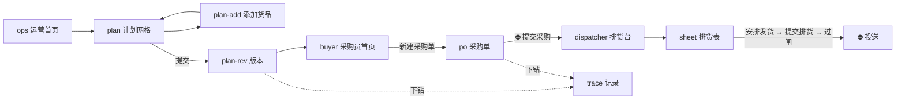

# 前端交互界面 — service_supplychain

> ★ **前端在本仓实现**（Q-1，2026-09-21 裁定）—— 前后端分离在**仓内**。
> 本文是**本仓前端的架构与交互规格**，不再是「给别人的规格」。
> jxd_ai_ops 降为下游：**数据查询分析 + AI 操作**，只消费 `api/pub/`。

| | |
|---|---|
| 版本 | v3（2026-09-21 前端并入本仓） |
| 状态 | 架构已定 · ★ 前端第一版未开工（`00d` W7） |
| 计划 | ★ `00d-前端并入本仓改造计划.md` |
| 上游 | `08` 接口 · `09` 用例 · `04` 状态流转 · `15` 排货 · `16` 边界 |
| 原型 | ★ `docs/prototype/index.html` |
| 作废 | ⚠️ `docs/html/` 是被否掉的早期设计稿，**不再维护，不要参照** |

---

## 0. ★★ 前端架构

### 0.1 栈与目录

```
web/                       React + Vite + TypeScript（Q-4）
├── src/pages/             按角色分：运营 · 采购员 · 排货员
├── src/api/               ★ 数据层：只打真后端（PB-D17 推翻 Q-6）
├── src/styles/            ★ 墨迹设计系统 —— 纯 CSS，从原型原样带来，不重画
└── dist/                  构建产物 → FastAPI StaticFiles 托管
```

★ **不引 UI 组件库** —— 墨迹系统已成形，再引一套等于两种视觉语言（`00d` §4）。

### 0.2 ★ 数据层只打真后端（PB-D17 推翻 Q-6）

```
api    打 api/ui/ 的真接口（唯一一档；内存后端只在 web/src/testing/ 供测试）
```

★ 没有档位可切：开发态就跑真后端 + 真 CH + 真领星，问题当场暴露（PB-D17）。
后端没起时页面显示「连不上后端 …（ECONNREFUSED）」，不是空白、不是假数据。

### 0.3 ★ 前端不许做的三件事（`01` §3.1 的 L8~L10，由测试强制）

| # | 不许 | 否则 |
|---|---|---|
| L8 | `web/` 里出现 PG / CH / 领星的连接 | 事务边界与出站网关全部失效 |
| L9 | `web/` 打 `api/ui/` 之外的路径 | 打 `api/pub/` 会让**契约被界面改动牵着走** |
| L10 | `api/pub/` 依赖 `api/ui/` | 改个界面把 jxd_ai_ops 打挂 |

### 0.4 ★ 界面文案仍受那条铁律约束

**不要写详细冗余的功能描述或解说**（`CLAUDE.md`）。
说明一律进折叠区（`.fold`），默认收起。★ **屏幕给数据，文档给论证。**

---

## 1. 八条交互原则（从领域来，不是审美）

### 一 · 量与态分开，不合成

```
✅  已下单  200 / 共 300
❌  部分已下单              ← 300 里下了多少看不见
```

### 二 · 两轴并置，不一致要高亮

```
我方进度  已投送
领星进度  待配货  ⚠
```

★ **不一致本身就是信息**（多半是 allocate 静默失败）。合成一个字段，信号永久消失。

### 三 · 三个真实的数并排，不给「可排量」

```
待排 160     可发 220     货在：上海 180 · 深圳 40
```

★ 合成一个数 = 替人做了我们已决定不做的分摊（C-4）。

### 四 · 不可逆动作长得不一样

| 普通 | ⛔ 不可逆 |
|---|---|
| `.btn--primary`，点了就做 | `.btn--danger` + ⛔ + 二次确认，弹窗列出**将要产生什么** |

### 五 · 闸失败要点名

```
❌  确认失败
✅  确认失败：3 项没过
    · 装箱数据不齐        第 3、7 行缺单箱重量
    · FBA 行缺目的地店铺  第 5 行
    · 可发量不足          DCC1800264 需 200，上海仓可发 180
```

★ **一次列全，不是修一条报一条** —— 修五轮才过闸，人就开始绕。

### 六 · 被丢掉的东西必须看得见

| 场景 | 必须显示 |
|---|---|
| 提交时跳过的格子 | `skipped[]` 逐条 |
| 建不出格子的 msku | 点名「这 4 个店铺没挂渠道」 |
| 排货表重建后丢掉的决定 | `dropped[]` |
| 查不到计划记录的行 | ★ 标红 + 「请先补销售计划」，不静默过滤 |

### 七 · 陈旧数据要标注（`.stale`）

```
品类  宠物用品 / 猫砂盆   ⚠ 已 6 天未刷新
```

### ★ 八 · 两种「人工输入」必须一眼分得开（N-8）

| | 生产里的来源 | 界面上长什么样 |
|---|---|---|
| ① 用户的活 | 人的判断 | 正常输入框 |
| ② 外部的返回 | 领星 / 亚马逊 / 采集 | ★ 明确标成「模拟外部」，**不混进业务表单** |

★ 把②画成①，就会得到**没人填得出来的输入框**（P15 的货件号即此）。
原型里②默认由顶栏「⏩ 推进一天」喂入。

> 采购下单的模拟外部已随 PB-D14 删除；下单只有真路径，测试用 tests/ 内替身（PB-D17：前端 `mock` 数据源同样已删）。

---

## 2. 页面清单（`docs/prototype/`）

| 页面 | 角色 | 干什么 | 原则 |
|---|---|---|---|
| `index.html` | — | 入口 · 角色导航 · 剧本说明 | — |
| `ops.html` | 运营 | 首页：待办 · 计划看板 | ①⑥ |
| `plan.html` | 运营 | ★ **计划网格**（店铺×货号×月） | ①⑥⑦ |
| `plan-add.html` | 运营 | 添加货品（认领） | ⑥ |
| `plan-rev.html` | 运营 | 版本编辑 / 提交 | ⑤⑥ |
| `buyer.html` | 采购员 | 首页：按店铺看、按货号组单 | ①③ |
| `po.html` | 采购员 | 采购单详情 · ⛔ 下单 | ④⑤ |
| `dispatcher.html` | 排货员 | ★ **排货台**（排货网格） | ③⑤⑥ |
| `sheet.html` | 排货员 | 排货单详情 · 装箱 · ⛔ 投送 | ④⑤⑧ |
| `trace.html` | 任意 | 记录下钻（计划单记录 → 采购 → 排货） | ②⑥ |

### 2.0 `web/` 采购页（React；路由见 `web/src/routes.tsx`，页面在 `web/src/pages/purchase/`）

> ★ 2026-10-10 起界面照设计系统「供应链工作台」采购单一节重做（设计 artifact `TCZbzG6ZdmT2BySP8mxyYJ`；计划 `superpowers/plans/2026-10-10-purchase-ui-redesign.md`，含与设计稿的偏离表）。
> 共用件 `parts.tsx`：⛔ `CommitButton`（不可逆动作独立形态，被挡时左侧点名原因、经 `aria-describedby` 读给按钮）· `StatusPair`（本地 | 领星两轴）· `GateList`（闸一次列全、未过在前、带后端闸名、标本地 / 服务端）。样式 `web/src/styles/purchase.css`。
> 编辑器：仓在单头、写到每一行（PB-D25）；逐店**直接打件数**（Enter / 离开即采用，绝对量，空 = 去掉）+「剩余全给」，不再有「加入」；底部 sticky 动作条，本地闸没过时 ⛔ 禁用并点名第一道与还有几道。确认弹窗：下单成功不自动跳，写出领星单号 +「去详情」；被拒时 ⛔ 禁用并写下一步。

| 路由 | 页面 | 干什么 | 原则 |
|---|---|---|---|
| `/purchase` | `PurchaseHome` | ★ **第一屏 = 待采购**（R3，PB-D18）：销售计划已提交、还没组满的记录（勾选 · 计划名（链到计划页）· rev · 货号 · 月份 · 总量 · 还可组 · 各店「期望 · 占比 · 已组」，只作参考 —— PB-D22 没有分店上限），按钮 **用选中的 N 条建采购单** → `/purchase/new?lines=…`。期望为空的店写「未知」，不当 0，记录照样能勾；已组满的记录折叠计数（★ 不显示「状态不可组单」—— PB-D29）。其下才是「需要人工处理」队列（点**打开**进详情）· 草稿 / 已下单计数 · 核对结果 · 「采购单」表；按钮 **新建采购单**。各个读各记各的错，一个挂了其余照出 | ⑤⑥ |
| `/purchase/new` · `/purchase/:poId`（草稿） | `PoEditor` | 草稿编辑器：★ 带 `?lines=` 进入时左栏只列这几条并展开，顶部写明来源「来自 销售计划「X」revN 的 N 条记录」（**加入其他待采购记录** 恢复全列），右栏每条明细显示来源链「计划名 revN 货号 月份 → 店 N 件」；★ 打开即按各店期望比例把带来记录的剩余预填好，期望全空的整条给一家店，人再改（PB-D30）。供应商 / 质检方式 / 各行仓、单价、预计到货、理由；候选表逐店 **加入**；**保存草稿** · **删除草稿** · ⛔ **下单**（有未保存的改动 / 新建时为 ⛔ **保存并下单**：先保存，后端检查过了才弹确认框，确认的是存下的那一份 —— PB-D23） | ①④⑤⑥ |
| `/purchase/:poId`（其余） | `PoDetail` + `AttentionPanel` | 领星状态：已下单的单**打开即现查**（PB-D27），写「状态 · 到货状态 读回于 时间」，读回失败照显上次观察并写明，**重新读回**；详情与处理区：**重新核对** · **登记已有单** · **确认领星无此单** · **确认知悉** | ②⑤⑥ |
| ⛔ 下单弹窗 | `PlaceDialog` | 列出将要产生什么；**确认下单** · **取消**；结果未知时按调用记录轮询、给 **重新载入** | ④⑤ |

★ `/purchase/:poId` 的分发（`PoRoute`）：未作废的草稿、且无未处理项、无卡住的调用、无在途的下单调用，才进编辑器；
其余进详情。读失败也进详情 —— 待核实 / 在途时后端拒改 / 删 / 下单（409），编辑器在那时只会是一屏点了必错的按钮；
队列或调用记录取不到则不赌它可编辑（失败即关闭）。采购单本身读失败，同样落到详情页由它点名取不到什么。

### 2.0b `web/` 排货页（阶段 C-a，页面在 `web/src/pages/dispatch/`；spec `superpowers/specs/2026-10-10-dispatch-draft-design.md` §7）

> C-a 只到「已确认 / 已取消」。C-b（spec `superpowers/specs/2026-10-12-dispatch-submit-ows-design.md`）加海外仓 **提交领星**；FBA 投送在 C-c 才出现（原则四：不渲染，不是禁用）。

| 路由 | 页面 | 干什么 | 原则 |
|---|---|---|---|
| `/dispatch` | `DispatchHome` | ★ 第一屏 = **未完成的销售计划**（CA-D11 · DL-D1），`plan_id` 倒序（DL-D4），★ 默认全部收起（DL-D5）。抬头：计划 rev · 「N 个货号 · M 条记录」· 需求 · 已组单 · 已下单 · 已排未发 · 已投送 · **还差**（最大字号，0 写「已满足」）· 排货表 chip · 动作；点抬头任意处 / 标题按钮 Enter 展开（抬头里的链接与按钮只做自己的事）。★ 展开体每个计划自带一张货号 × 月小表（DL-D2，各计划月份不同，不共用列头）：货号 · 品名（单行省略）· 每月一列（★ 只列有记录的月，DL-D10）· 还差合计，货号行按还差合计降序；格子大字还差、小字 `/需求`（DL-D6），0 写「已满足」，★ 该货号该月没有记录写「—」（≠ 0，≠ 已满足），悬停 / 读屏给 需求 · 已组单 · 已下单 · 已排未发 · 已投送，同格多条记录相加并在尾部写「（N 条记录）」（DL-Q5）—— 取消排货表后还差立即回来。★ 排货表 chip「#N 去向 下一步」（DL-D3 / D7 / D8：只用本地事实，列表不现查领星；词表与优先级见 spec `superpowers/specs/2026-10-15-dispatch-list-redesign-design.md` §4，「正在提交…」排最前，多条命中写「+N」；FBA 补锁排在提交之前，提交领星的 N 按领星单数（DL-D11 · DL-D12）；排货单全部被回执归档写「领星已完成，已归档」（中性，排在所有情形之后，DL-D13）；不再单独显示「已确认」、不显示闸未过数；都不命中写表状态原文并 `console.warn`（DL-Q6）；旧版混合表写「旧版混合表：只能取消」（DL-Q8））。★ 动作（CA-D13）：已有草稿 **接着平台仓 · FBA #N** / **接着海外仓 #N** 为主按钮，没有草稿的去向 **平台仓备货 · FBA** / **海外仓备货** 为次按钮，横排；已满足的计划不给。★ 搜索 计划名 / 货号（DL-D10，纯前端）：命中货号的计划自动展开、命中行高亮；没命中写「没有匹配的计划或货号」。「全部排货表」进折叠区、默认收起（DL-D9），标题带张数与已取消张数，展开后带对应计划与「去向」列（旧版混合表写「旧版混合」）。两块（计划 / 全部排货表）各自读、各自点名错误；★ 计划响应缺字段时只在计划块点名缺哪张表 / 哪条记录缺什么字段并写「后端版本与页面不一致」，不给默认值（缺 ≠ 0），全部排货表不受影响。★ 排货表详情页（`/dispatch/sheets/:sheetId`）底栏在途写调用时写「正在提交…」（DL-D8，与 chip 同词），**提交领星** 按钮不禁用（DL-Q7，后端本就 409）；后端响应缺 `in_flight` 时底栏写「读不到在途写调用：后端缺字段 in_flight」并 `console.error`（缺 ≠ 0） | ①⑥ |
| `/dispatch/sheets/:sheetId` | `SheetPage` | ★ 排货工作台（2026-10-12 照设计 artifact `TCZbzG6ZdmT2BySP8mxyYJ` 的 DispatchSheet 重做，样式 `web/src/styles/dispatch.css`）。**页头**答「这张计划还差多少」：需求 · 本表已排 · 别的表已排未发 · 已投送 · **还差** · 「N 条还差，M 条已满足」，库存截至 / 读不到的原因。**左栏记录清单**：页签 计划记录 / 无计划来源；筛选 还差 > 0（默认）/ 本地有货 / 全部；每条 还差 · 需求 · 本表 · 别表 · N 个仓有货；折叠「未列入」给出 `excluded` 计数。**右栏「安排」**答「货在哪」（★ CA-D12：每个数带来源 —— 「领星现读 / 领星读回 时刻」或「采集 截至 时刻」，按浏览器本地时区显示；记录头上 **现查领星** 现读这个货号的本地库存并读回关联采购单，成败分开点名）：需求 · 采购（已组单 / 已下单 / 已入库 · 待到货（整单）/ 采购单：单号 · 状态 · **入库仓**（采购单行的仓，不在本地仓列表里写仓号）· 本记录件数 · 入库 / 待到 · 来源时刻）· 本地库存（只列有货的仓：共享桶 + 每店可安排，负数写「已超 N」，注「含本店桶 N」）三块并排不相减；店 × msku 逐行，已有格子「来源仓 → 目的地 件数」可直接改（回车生效）/ **撤回**；★ 选目的仓（10-13 负责人：「在选择目标海外仓时给出提示，提示用户选择第三方的海外仓必须配对产品后才能提交备货单」）：下拉里第三方仓（`kind = oversea_3pl`）标「（第三方仓 · 需配对）」；选中第三方仓 → 下方提示「第三方海外仓：货号须在领星配对三方 sku 后才能提交备货单」并现查配对（核对中… / ✓ 已配对（三方编码…）/ ✗ 未配对：先让三方仓建好这个产品，再在领星「海外仓 → 产品配对」里配上 / 这个仓没接 API）；已排格子的目的地是第三方仓的标「第三方仓 · 需配对」。页头带去向徽标（「平台仓 · 亚马逊 FBA」/「海外仓」/「旧版混合表：只能取消」）。★ **默认分配**（UX-D7，读 `detail.autofill`）：页头下一行写「新建时系统填了 X 格 Y 件默认排货量，跳过 Z 条」（0 格时「新建时没有可默认填的格子」），折叠区「规则与跳过」默认收起（规则一句 + 逐条跳过原因）；没做成 → 不折叠「默认分配没做成：原因（哪一步），格子要人填」+ 错误码；系统填的格子旁标「默认」，人改过件数标「默认 N，已改」；没有事件（海外仓表 / 迁移前的表）什么都不写。「别的表已排未发」= 别的表未发的（本表已投送的不再算进本表已排，评审 P1 #11）。「加一格」来源仓只列有货的仓；目的地只列**本表去向**的（CA-D13）：FBA 表只有本店 FBA、已带上，海外仓表列本市场海外仓、**不预选**；旧版混合表不给加格子；件数 + **排**，快捷 **排 N**（= min(还差, 可安排)）；撞上已有格子不发请求。每次写完一行反馈（已排 N 件 … / 超出可安排 / 服务端错误码点名，不出 toast）。**右栏「排货单与装箱」**：系统派生、只读，装箱 6 列只在 FBA 单渲染，失焦保存。**右栏「确认检查」**：三态闸（✓ / ✕ / ？），G5 恒「？」不拦。**底部常驻**：每张排货单一个 chip（缺装箱 N）· **取消排货表**（弹窗要理由；已确认也可取消，CA-D7）· 未过的闸名 · **确认排货表**（有未过 / 无法判定的闸时不可用）。★ **C-b 提交领星**：「排货单与装箱」里每张海外仓单有 **物流方式** 下拉（草稿可选，冻结后只显示；G7；选项写「渠道 · 方式 · 物流商」—— 领星同名渠道多，只有物流商分得开；没选时醒目写「还没选物流方式」；「确认检查」里 G7 未过带 **去选物流方式** 直接跳到这一页）、写出领星备货单号（按来源仓，已删的划掉）与 已投送；已确认后底部 **提交领星（N 张）**（有阻断项 / 待核实时不可用，阻断项逐条点名）→ ⛔ 确认框逐张列出 参考号 · 来源仓 → 目的仓 · 物流方式 · 件数 → **确认提交** → 逐张结果（出错就停在那一张，其余写「没有发」；前端等不到 = 结果未知，刷新看）；全部建齐写「海外仓备货单已全部提交领星」。待核实时页头下红条逐张点名，三个出口：**重新查** · 填单号 **登记** · 填理由 **确认领星无此单**。取消框在有已建备货单时写明「会同时删除领星备货单 N 张（单号…）」。★ **两条链同一个按钮**（10-13 负责人：「这 2 个操作的交互流程要保持一致」）：已确认的海外仓表与平台仓 · FBA 表底部都是「提交领星（N 张）」；预览还在核对（海外仓现查三方 sku 配对实测 4.5 s）时按钮照样在，写「提交领星（核对中…）」不可点；有阻断项时按钮在、不可点、旁边逐条写原因与去哪改。★ **C-c1 FBA 发货计划**（CC-D1）：平台仓 · FBA 表确认后同样有「提交领星（N 张）」，⛔ 确认框写明「建 FBA 发货计划 … 建后锁定本地仓库存；STA 建货件 / 发货在领星里做」，列 参考号 · 来源仓 → FBA 店 · 装箱 · 件数；建了没锁上 → 按钮变「补锁库存（N 张）」（只补锁不重建）→ ⛔ 确认框「补锁库存：N 张 FBA 发货计划」列出要补锁的那几张 → **确认补锁**（2026-10-16 修 P0：原先按「要新建的单」放行，补锁时永远灰）；排货单写「领星发货计划 RP… · 计划 R… · 已锁库存 / 库存未锁」；全部提交后底部「已提交领星 FBA 发货计划：请在领星完成 STA 建货件 / 发货」；取消框写明会释放库存、计划需在领星手工作废，取消后页头常驻点名要手工作废的计划号（CC-D4）。★ **回执**（CB-D9；10-13 负责人：「需要有类似采购单一样的状态回读小按钮」）：同采购单（PB-D27）—— 有未作废领星单的表**打开即现查一次**；每张领星单两轴并排「本地 <我方进度> | 领星 <进度> 读回于 <时刻>」+ 小按钮 **重新读回**（还没读回写「未读回」/「正在向领星查询…」）；这一张没读到 → 只在这一张上写「这次读回失败（原因码），显示的是上次读回的状态」+ 折叠原因；读回请求本身失败（如 `sheet_busy`）→ 每张写「读回请求失败：…」，★ 不当成领星状态；两轴不一致醒目「⚠ 领星已撤销 / 领星里没有这张单（我方仍是已投送）」；底部排货单 chip 带「领星 <进度>」，不切页签也看得到；归档了哪些单写在页上。★ **退回修改**（CA-D14）：已确认、且这张表一张单都没发到过领星时，底部有「退回修改」（弹窗要理由）→ 回草稿，格子 / 目的地 / 物流方式都能改，再确认重跑闸；发到过领星就不给，只能取消。海外仓草稿表的已有格子带「改目的地」下拉（同一事务挪格，件数不变）。提交预览读不到只在底部点名，不拖垮整页。平台仓 · FBA 表确认后底部写明「提交到亚马逊（STA）还没做」，不渲染提交领星 | ①③④⑤⑥⑦ |


★ 三个角色共用**同一张网格心智模型**：`plan` / `buyer` / `dispatcher` 都是
「店铺×货号×月」，只是列不同。换页不换脑子。

★ 外壳（`shell.js`）全局提供：角色切换（运营 / 采购员 / 排货员，各自 home）·
当前模拟日 · **⏩ 推进一天** · toast · 确认弹窗。

---

### 2.0c `web/` 添加货品（`/plans/:planId/add`，`web/src/pages/PlanAdd.tsx` · `SkuPicker.tsx`）

| 在哪 | 干什么 | 依据 |
|---|---|---|
| 搜货号输入框 | 边输入边提示（停 250ms 查一次，下拉最多 20 个货号：货号 · 品名 · 「可认领 a/b」/「已被占用」/「已选」）；超出写「命中 N 个，只列前 20，继续输入缩小范围」；没命中写「没有命中的货号」。★ 空输入聚焦列「以前计划里用过的」，没有写「还没有计划用过的货号，输入货号、品名或 msku 搜索」，对不上货号的认领记录点数。↑↓ · Enter · Esc；输入一变旧结果作废，乱序回来的旧请求丢弃 | S-25b · P11 |
| 已选货号区 | 选中的货号进区内（最近选的在上），可认领的 msku 默认全勾，被占用的照列并点名占用方；**不选这个货号** 移出并去掉它的勾；顶部 **反选** 翻转所有已选货号下可认领 msku 的勾（被占用的不参与）；**添加** 之后按货号重取占用 | P11 · 原则五 |

## 2.5 ★★ 操作流程 —— 实现必须照这条路径

> 表里**粗体 = 原型里的按钮原文**；「去到」列的页面 = 原型里真有的跳转。
> `test_doc_flow.js` 按这张表逐个核对 —— 改了路径要同时改两边。
>
> ⚠️ **这些表记的是「冻结的老原型」的真实路径**（负责人 09-21 裁定：老原型不改、重建，
> 见 `00c` S7）。留着它并继续核对，是因为**空检查不会失败** ——
> 把它改成「新原型规格」而新原型还不存在，这条门禁就等于关掉了。
> ★ 新原型要改的地方以 **§2.6 delta** 为准。

### `web/` 新建销售计划 · 从 Excel 导入（IM-D6 / IM-D10）

> 这是 `web/` 的表单，不在冻结的老原型里；故不用「在哪」列的表，`test_doc_flow.js` 不核对它（它只核 `.html` 原型页）。
> 文案以 `web/src/pages/OpsHome.tsx` 为准，改文案要同时改这里。

| 位置 | 显示 / 动作 |
|---|---|
| 「我的计划」页头 | 两个按钮并排：**从 Excel 导入** · **新建销售计划**。（★ 10-22：导入原先藏在新建表单里当「可选」，负责人在页面上找不到 —— 拆成独立入口） |
| **新建销售计划** | 展开表单：标题 · 起始月 · 跨 N 月 · **新建** · **取消**；**新建** = 建空计划（`POST /v1/plans`），跳 `/plans/{plan_id}` |
| **从 Excel 导入** | 展开表单：标题 · 起始月 · 跨 N 月 · **Excel 文件**（仅 `.xlsx`）· **下载模板** · **导入** · **取消**；没选文件 **导入** 不可点；**导入** = `POST /v1/plans/import`，一步建好计划 + 认领 + 填数，跳 `/plans/{plan_id}`；请求中按钮禁用（I3 防双击） |
| **下载模板** | 链接 `GET /v1/plans/import/template?period_start=&months=`，随表单里的起始月 / 月数变 |
| 422 `import_rejected` | 表单下方红色块：「计划没建：有 N 处问题」+ 逐条 `第 N 行 X 列 · msku/货号 · 原因`；表头错写成 `表头 · …`（`row=0`）。选的文件保留，改完可重选；同时弹 toast |
| 其它错误 | 走通用错误块 + toast，不列明细 |

### `web/` 计划页的提交结果（R1 / D5，S-35 / S-41）

| 位置 | 显示 |
|---|---|
| 摘要 | 「已提交 rev N，这一版 N 条」；只有存在 `no_claimed_msku` 才是警告色 |
| 四个数 | **保留 · 替换 · 新增 · 去掉**，各自带标签；替换 / 去掉明细进折叠（默认收起）；`split_frozen`、`left_completed` 非空才出现，同样折叠 |
| 跳过 | 「采购量为空 N 个」「采购量为 0 N 个」各一行**灰字计数**，明细折叠；**红色只给** `no_claimed_msku`；未知 `reason` 原码红块显示，不吞 |
| 409 `lines_in_purchase` | 逐条列 货号 · 月 · 状态 · 这次改了量（旧 → 新）/ 不再包含；采购单号链到 `/purchase/{po_id}`；摘要「要改动的记录已进采购，这次提交没有生效」 |
| 去采购 | 「去采购（N 条待采购）」→ `/purchase`；N 取自提交后一次 `GET /v1/plan-lines?orderable=1&plan_ids=`，取不到则只写「去采购」并折叠点名原因 |

### 运营 · 从建计划到提交

| # | 在哪 | 做什么（按钮原文） | 去到 |
|---|---|---|---|
| 1 | `ops.html` | **新建销售计划** | `plan.html?plan=` |
| 2 | `plan.html` | 网格空 → **添加货品** | `plan-add.html?plan=` |
| 3 | `plan-add.html` | 勾货品 → **添加** | 回 `plan.html` |
| 4 | `plan.html` | ★ 填期望销量（msku×月）与计划采购量（货号×月） | 原地 |
| 5 | `plan.html` | **提交** → 铸计划单记录 | `plan-rev.html?plan=` |
| 6 | `plan-rev.html` | 看版本 · **设为当前使用** | `trace.html?line=` 下钻 |

★ 第 4 步是运营**唯一**的人工编排动作。`plan.html` 上的其它数（系统预估、在途、
到货）都是**铅笔灰或石绿**，不可编辑。

### 采购员 · 看的时候分店，下单的时候合并

| # | 在哪 | 做什么 | 去到 |
|---|---|---|---|
| 1 | `buyer.html` | ★ 按店铺看候选（这是「看」的口径） | 原地 |
| 2 | `buyer.html` | **新建采购单** → 选供应商 → **创建** | `po.html?po=` |
| 3 | `po.html` | **添加** / **添加勾选的行** ★ 按货号合并（这是「下单」的口径） | 原地 |
| 4 | `po.html` | **保存草稿** 或 ⛔ **提交采购** | 原地 · 二次确认 |
| 5 | `po.html` | 到货后下钻 | `trace.html?line=` |

★ **同一批需求，两种口径**：`buyer.html` 分店铺陈列，`po.html` 按货号合并成行。
店铺归属是**被记录的人的决定**，不是从别处推出来的 —— 合并时不许丢。

### 排货员 · 网格是唯一入口

| # | 在哪 | 做什么 | 去到 |
|---|---|---|---|
| 1 | `dispatcher.html` | 排货台：看已有排货表 / 候选三数并排 | `sheet.html?sheet=` |
| 2 | `sheet.html` | 没有排货表 → **新建排货表** | 原地（`?sheet=`） |
| 3 | `sheet.html` | ★ **安排发货** —— 在网格格子上填「哪个本地仓、多少件」 | 原地 |
| — | | 填错了 → **撤回**（量退回「还能排」，格子回到没安排过） | 原地 |
| 4 | `sheet.html` | 填装箱数据（系统要不到的东西） | 原地 |
| 5 | `sheet.html` | **提交排货** → 跑 6 项闸 | 原地 |
| — | | 没过 → ★ 一次列全未过项，排货表**仍是草稿** | 原地 |
| — | | 过了 → 排货表转「已确认」，每张排货单上才出现「投送」 | 原地 |
| 6 | `sheet.html` | ⛔ **投送** + 渠道（`FBA 5 步` / `海外仓 3 步`） | 二次确认 → 逐步展示 |

★ 这条路径上的三个硬规矩：

```
① 安排发货是排货员唯一的人工编排动作 —— sheet.html 上写着「安排发货的唯一入口」
② 排货单由安排派生，人不建、不改（N-3）
③ 「投送」在过闸之前不存在 —— 不是禁用，是不渲染（禁用会让人以为该点）
```

### 整条链



## 2.6 ★★ S7 新原型必须与老原型不同的四处

> 权威定义在 `15`（排货逻辑）与 `03`（表与恒等式）。这里只列**差异**，不复述。

| # | 老原型 | ★ 新原型 | 依据 |
|---|---|---|---|
| 1 | 网格与待编排池两个入口 | ★ **网格是唯一入口**，没有池子 | N-3 · N-4 |
| 2 | 人手建排货单、还要选 FC | ★ **排货单由安排派生**；FBA 只到店铺 `sid` | N-3 · N-5 · O-1 |
| 3 | 投送一键到底 | ★ **投送中间有一道人工闸**：在 placement option 之间选（各自的货件拆法 · FC · **费用**） | ★ O-7 |
| 4 | 行上显示一个货件号 | ★ **显示 N 份货件**及各自 FC；★ 归属未知要**点名**，不许当 0 | O-2 · 承重墙③ |
| 5 | 没有 | ★ **新增「计划 vs 实际」模块**（UC-O10）：msku × 月，两个数并排 + 差额，★ **不合成达成率** | R-5 · R-6 |
| 6 | 没有 | ★ **新增「发货单管理」**（UC-D14）：发货单 → 货件 → ★ **头程收货状态** | R-6 |
| 7 | 采购页只有 `buyer.html` / `po.html` 两页 | ★ **采购前端**（`web/`）：首页 + 编辑器 + 详情三页，处理区放详情；编辑器只对「可编辑的草稿」开放（§2.0） | PB-D16 · `web/src/pages/purchase/PoEditor.tsx` `PoRoute` |

★ 第 3 条是我文档里一直漏掉的**一个人**：`confirmPlacementOption` 原先被写成系统自动确认。
它带费用差异且不可逆 —— 自动选等于替人花钱，而且没人知道花了多少。

★ 第 4 条的界面判据：`gap != 0`（拆分对不上）与 `splits_seen = 0`（还没回读到）
**是两种不同的病，处置相反**，屏幕上必须分得开。

---

### ⚠️ 老原型里与本节不符的入口（冻结，S7 重建时按 §2.6）

| 位置 | 现状 | 违反 |
|---|---|---|
| `dispatcher.html` 「**新建排货单**」`doCreate()` | ★ 让人先选 **FBA 店铺 + FC**，`dest.fc` 缺了就报错 | ★ **N-5**：FC 由亚马逊动态分配，此刻**根本不存在** —— 与 P15 的货件号同病 |
| 同上 | 人**手建排货单** | ★ **N-3**：排货单 = f(安排)，应由安排派生 |
| `sheet.html` 「待编排」与**撤回** | 仍有池子语义 | ★ **N-4**：待编排池取消 |

★ 这三条是**同一个根因**：人的输入没有自己的落点，于是塞进了派生物。
`dispatch_arrangement`（`03`）已补上；老原型的 43 处池子语义**不再逐处修**，由 S7 重建。

---

## 3. 设计系统 —— 墨迹语言

### 3.0 ★ `web/` 已换用设计系统「供应链工作台」（2026-09-23，负责人裁定）

负责人裁定：墨迹语言的**观感**（冷纸、墨色、3px 裁切）与计划网格的**交互**（销量表与采购表分开、
失焦即存的小输入框）都不再沿用。`web/` 改用设计系统「供应链工作台」（claude.ai 设计系统工件，
token 转写在 `web/src/styles/tokens.css`，浅 / 深两套主题）。§3.1–3.3 从此只描述**冻结的老原型**。

★ 墨迹语言的**区分**保留，只是换了写法 —— 一个数是哪种数，仍然一眼分得开：

| 区分 | 老原型 | `web/` |
|---|---|---|
| 机器估的 | 铅笔灰 `--pencil` | `--text-3`，字重 500 |
| 人写的 | 蓝黑墨 `--ink` | `--primary`（深青）+ 格子左上角三角 |
| 没人填、也没有预估 | 空输入框 | `--warn`「待填」 |
| 要人处理的 | 朱批 `--vermilion` | `--danger` / `--danger-soft`（断货）· `--warn-soft`（偏低） |
| 已落地的事实 | 石绿 `--jade` | `--ok` |

★ 计划编辑页（§2.5 运营第 4 步）改为**计划整表**（设计系统 `PlanSheet`，2026-09-24 负责人裁定，
取代同日早些时候的「一个货号一张卡」的计划矩阵 —— 货号一多，卡片一张张往下翻就没法操作）：

- 几百个货号放在**一张表**里：货号行填计划采购（格内副数是各店销量与在途），其下店铺行填销量
  （副数是期末库存）；多 msku 的店铺展开后逐个 msku 填。
- 货号可整组折叠；**全部折叠就是「一行一个货号」的总览**。
- 找格子：搜索 · 筛选（全部 / 有断货 / 有待填 / 偏低）· 排序（风险优先 / 销量 / 货号）·
  **N 跳到下一格待填**（只找销量格 —— 采购空着是「不买」，不是没填）。
- 键盘表格照旧（直接打数字、Enter / Tab 移动、Delete 清掉人填、粘贴 Excel、⌘D / ⌘R 填充），
  ⌘D 只在同一类行之间填。每格独立保存。
- 只渲染看得见的行（行高固定）。
- ★ **三个移出按钮**（2026-09-27 业主裁定，`00` Y 组）：货号行「移出货号」（全部店的 msku + 采购格，一次调用）·
  店铺行「移出该店」（只这一家店的该货号 msku；~~原名「移出货号」~~）· msku 行「移出 msku」。
  按钮字面即动作名（货号行、店铺行各写全称）；同一货号的三种移出互斥（一个在飞，其余置灰）。
  toast 动词随按钮名；丢弃的期望 / 计划采购逐格带值点名。移走的是货号的最后一个 msku 时，货号连同采购格一并移出
  （~~采购格「未删、待处理」~~ ★ 作废）。

口径不变：采购仍是货号级、在途不分摊到店铺、~~库存不含本计划采购~~（★ **09-24 起作废**，见下「预测与库存」：库存含计划采购到货）、空 ≠ 0、不适用 ≠ 0；
数仍全部来自 `planGridModel`，整表只按货号重新分组。行高、偏低线等展示取值见 `00` W 组。

#### ★ 预测与库存（2026-09-24，规格 `superpowers/specs/2026-09-24-plan-forecast-design.md` §5）

库存数改由后端逐日台账给（`08` grid 的预测块），界面只展示、不重算（`05` §5.0）。

- ★ **填什么一眼分得开**（10-15 负责人：「SKU 行是要求填计划采购数量，而 msku 行是填计划销售数量，目前的 UI 如果我不说，运营是不会懂的」）：可填的主数前面写名字 —— 货号行「**计划采购**」（蓝）、单 msku 的店铺行与 msku 行「**计划销量**」（绿），紧凑时缩成「采 / 销」、全称在 `title`；可填格画成输入框（细边框 + 左侧色条，悬停出 ✎，不改底色 —— 偏低 / 断货照常着色）；可填但空着写灰字「填采购量」，不写「—」（「—」只留给读不到的数）；多 msku 的店铺行写「计划销量 N 自动合计」、不画输入框；行头标签「填计划采购」/「填计划销量」；合计列写「计划采购 N」「计划销量 N」。★ 屏上「期望」一律改称「计划销量」（含依据弹窗、到货分配说明、错误文案）。
- **三种行的副数，带文字标签**（★ FM-D1，10-15 负责人：「文本也应该改成: 销量预测, 月末库存, 当月在途」）：货号行「销量预测 · 月末库存 · 当月在途」；店铺行「销量预测 · 月末库存」；msku 行「销量预测 · 月末库存」（FM-D5：当月在途只在货号行）。
  ★ FM-D4：三个数都是按钮 —— 悬停 `title` 一行组成（销量预测：货号「店铺 a + 店铺 b（不适用的写「不适用（不计）」）」/ 店铺「msku a + msku b」/ msku「速率 件/天 × 天数」；月末库存：「期初 X（或 现有 X）− 计划销量 Y + 到货 Z = 月末」；当月在途：「FBA 货件 a + 海外仓 b」，读不到写「读不到」），点击打开依据弹窗：销量预测按店铺 → msku 逐条（速率 × 天数 · 取数窗口）；当月在途按来源逐条（FBA 货件：货件号 · 店铺 msku · 件数 · 送达时段；海外仓备货单：单号 · 件数 · 发出 · 预计到达；只计本月的点名）+ 「FBA 货件：采集于 …；海外仓：领星实查于 …」+ 「采购管道 N（不计入当月在途）= 生产中 + 货运中 + 已下单未到」（FM-Q1）。读不到时当月在途写「—」，弹窗写原因。
  ★ 「月末」= 该月**月末预计库存**（期初 − 计划销量 + 到货，`title` 写全称）—— 原标签「库存」被运营当成现在的库存去对领星（10-14，`00` OP-19）。
  ★ 台账起点那一格（as_of 所在月，或 as_of 在计划之前时的首月）店铺行 / msku 行另写「**现有** N」= as_of 当天 FBA 可售 + 调仓中（OP-19 c），
  `title` 拆成「FBA 可售 a + 调仓中 b」并写采集日（每日采集，与领星实时数可差当天的变动）；店铺 = Σ msku，任一 msku 没有起点就不写（不拿部分和冒充）。
  紧凑密度下货号行用单字「销 / 存 / 途」，全称在 `title` 上。预测不适用（没有销量取数源）写「不适用」，
  无 FBA 的店库存写「无 FBA」—— 都不是「—」（不适用 ≠ 未知）。
- **库存含本计划采购到货**：到货日 = 下单月 15 号 + 生产天数 + 货运天数；图例 chip 写明用的天数。
  在途 = 生产中 + 货运中 + 已下单未到（采购管道）；★ 已发出的 FBA 货件按送达结束日**进月末**（spec 2026-10-14），不在在途里重复计，采购管道与 FBA 货件进月末的件数在月末库存的依据弹窗里写。
  依据面板：msku 到货逐条「MM-DD 到货 N（FBA 货件 X，送达 a–b，按结束日）」；货号行写 FBA 货件件数，送达时段已过未签收 / 没有送达时段的单列「未计入」，窗外的照列「周期外」；起点有调仓中时写「现有 N（可售 a + 调仓中 b）」。
- **点开一格看依据**（`ForecastBasis`）：库存数字是按钮，点开是面板 —— 期初 → − 期望 → + 到货 → = 期末 → 下月期初，
  每一环给数；as_of 到首月之间的扣减、as_of 落在月中的那一段，都逐步给到能复算（月总量 × 半月天数权重 → 向上取整）；
  货号行另给在途拆分（逐笔采购单写**预计到货月**，逾期的标「已逾期」）、周期外到货、分不出去的到货。
  说明文字进面板底部的「怎么算的」折叠区，默认收起。
  ★ 依据按钮不进 Tab 序；**光标格上按 `I`** 打开它的依据（键盘提示条有 `I 看依据`）。
- **提前期设置**（`LeadTimeBar`，计划页顶部）：显示生产 / 货运天数与下单锚点日，「改提前期」→ 两个整数框 → 保存；
  全局一份、所有计划共用（`14` B12），保存成功后整表重拉重算，失败走 `ErrorDetail` 点名。
- ~~mock 模式不重跑台账（OP-17）~~ ★ 作废（PB-D17）：mock 已删，没有这个分支。

### 3.1 论点

★ **把说明文字换成墨色。**

系统里到处是「这个数是什么性质」的区分 —— 事实 / 假设 / 人的意图。
这些区分以前靠说明文字写在屏幕上，结果说明比数据还多。现在用墨说：

| 墨 | token | 说的是 |
|---|---|---|
| 铅笔灰 | `--pencil` `#8B939B` | ★ 机器估的（系统预估、外推值） |
| 蓝黑墨 | `--ink` `#16293D` | ★ 人写的（期望销量、计划采购量） |
| 朱批红 | `--vermilion` `#C4342A` | ★ 要人处理的（缺口、断货、被拒） |
| 石绿 | `--jade` `#2E6B54` | ★ 已落地的事实（到货、已投送） |

★ **一个数用哪种墨，就说明了它是哪种数** —— 不用再写一句话。

纸：`--paper #F0F1ED` 冷纸（偏绿灰，**不是暖奶油**）· `--paper-hi` 抬起 · `--paper-lo` 压下 ·
`--rule` 格线 · `--rule-hard` 分区线。

### 3.2 版面三条手法

| # | 手法 | 类 |
|---|---|---|
| ① | ★ **说明折叠成一行**，默认收起 —— 信息还在，版面还给数据 | `.fold` `.fold__body` |
| ② | ★ **网格占满** —— 一行标题 + 一行元数据 + 一行参数，剩下全给数据 | `.sheet` `.sheet__scroll` |
| ③ | ★ **状态用左边条不用徽章** —— 徽章抢注意力又占位 | `.cell[data-state]` |

`data-state`：`low` 淡朱 · `out` 朱批 + 淡底 · `done` 石绿。

### 3.3 主要组件类

| 组 | 类 |
|---|---|
| 外壳 | `.shell__bar` `.shell__roles` `.shell__day` `.shell__crumb` |
| 网格 | `.sheet` `.sheet__head` `.cell` `.cell__rows` `.cell input.g` |
| 数 | `.qty` `.num`（`tabular-nums`）· `.qty-of`（200/300）· `.qty--zero` |
| 墨 | `.i-ink` `.i-pencil` `.i-red` `.i-jade` |
| 态 | `.chip` + `--ours` `--ext` `--ok` `--bad` `--warn` `--dim` |
| 闸 | `.gate__item` + `--pass` `--fail` · `.gate__detail` · `.gate__code` |
| 时间位移 | ★ `.shift` `.shift__line` `.shift__cap`（下单→完工→到货的提前期） |
| 动作 | `.btn` + `--primary` `--danger` `--ghost` `--sm` · `.irreversible` |
| 丢弃 / 陈旧 | `.dropped` `.stale` |
| 反馈 | `.toast` + `--ok` `--fail` `--warn` · `.flash` · `.modal__*` |

★ `.chip--ext` 是**领星的数据**：灰。我们改不了的东西，视觉上就该退后一层。

★ 组件类由 `shell.js` 生成，**必须在 `shell.css` 里有样式** —— `test_css.js`
按 AST 推导核对。曾有 42 个类无样式而页面照常渲染：**没有样式不会报错。**

---

## 4. 核心交互

### 4.1 ★★ 排货：网格是唯一入口

> ⚠️ 本节是 N-2~N-4 裁定后的**目标形态**；原型尚未改造（`16` §4 的 S2/S3）。

```
排货网格（店铺 × 货号 × 月）—— 和计划网格同形
┌──────────┬─────────┬─────────┬─────────┐
│ DCC1800264│ 2026-10 │ 2026-11 │ 2026-12 │
│ A4Pet-US  │ 待排 160│         │         │
│           │ [上海▾] │         │         │
│           │ [ 120 ] │         │         │
└──────────┴─────────┴─────────┴─────────┘
       ↑ 人只填这一格                     排货单在下方派生，只读
```

| 规则 | 为什么 |
|---|---|
| ★ **人只填「安排发货」的格子** | N-2：其余按流程自动完成，只有完成不了才要人 |
| ★ **排货单 = f(安排)**，只读 | N-3：改安排就重算 |
| ★ **没有「待编排池」** | N-4：它是手动编排的产物 |
| ★ 三个数并排，不合成 | 原则三 |
| ★ 装箱数据在排货单上填 | 系统要不到的东西（A-8） |
| ★ **FBA 的目的地只有店铺 `sid`，没有 FC** | N-5：FC 由亚马逊动态分配，且一计划拆 N 货件 |
| ★ 海外仓**没有**装箱那栏 —— 不是禁用，是不存在 | 禁用会让人以为该填 |

★ 「海外仓没有那栏」是这页最要紧的一处：它把**平台仓与非平台仓的差异变成看得见的形状**，
而不是一条人必须记住的规则。

### 4.2 确认闸

★ 一次列全未过项，每项点名到行，给「跳到那一行」的链接。
★ **过了的项也显示**（打勾）—— 人要知道检查过哪些，否则下次还会怀疑。

### 4.3 投送：⛔ 与 partial

```
即将投送 排货单 #2（美国 FBA）
⛔ 本次将产生真实亚马逊货件，无法撤销
将依次执行：建发货计划 → 锁库存 → STA 建货件 → 建发货单 → 发货
```

结果**必须逐步展示**（`.modal__steps`，`data-state` = `ok` / `manual` / `pending`）：

```
✅ 建发货计划   RP240917001
✅ 锁库存
✅ STA 建货件   FBA16XNMN3N4
✅ 建发货单     SP240917001
⚠ 发货         超时，需人工核实

我方进度：已确认（★ 未推进到已投送）
```

★ **不许只显示「失败」** —— 前四步真的发生了，那张单**真实存在于领星里**。
只说失败，人会以为什么都没发生，然后重投一次。

---

## 5. 老原型（★ 已冻结，只作参考）

```
docs/prototype/
├── index.html              入口 · 角色导航
├── {ops,plan,plan-add,plan-rev}.html      运营
├── {buyer,po}.html                        采购员
├── {dispatcher,sheet}.html                排货员
├── trace.html                             下钻
├── assets/shell.css        ★ 墨迹语言（唯一样式来源）
├── assets/shell.js         ★ 外壳：角色 · 推进一天 · toast · 弹窗
├── assets/store.js         ★ 领域逻辑 + localStorage（预测 / 采购 / 排货）
└── test_*.js · replay.sh   见 CLAUDE.md
```

★ **冻结，不再修**（负责人 09-21）—— 43 处池子语义分批改必然留下一半新一半旧。
★ 产品前端在 ★ `web/`（React，`00d` W7）；★ `store.js` 的**预测核心**要移植过去，
**判据：逐格对上同一组数**，否则不算完成（`00d` §2）。
★ `shell.css` 墨迹系统**原样带走**，纯 CSS，不重画。

---

## 6. 悬而未决

> ★ 未决项只在 `00-待裁定清单.md` 一处维护。

| # | 状态 |
|---|---|
| C-1~C-6 | ★ P0 领星实调，仅存的未决；**C-6 未答之前不许写行→货件的推断逻辑** |
| S2 / S3 | 原型改造成派生排货单、去掉待编排池（`16` §4） |
